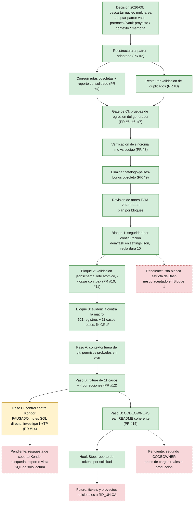
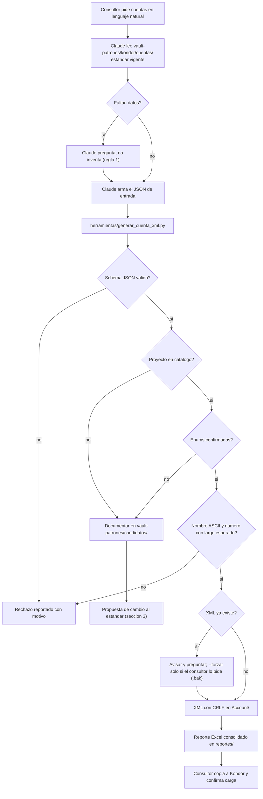
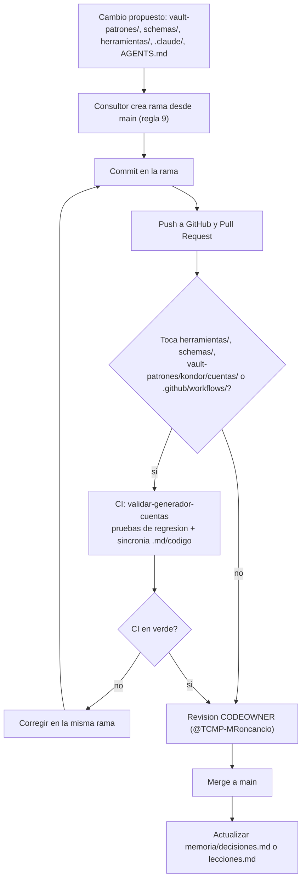

# DAG de la iniciativa y del manejo del repositorio

Vista en grafo dirigido aciclico (DAG) de como avanzo la iniciativa y de como se opera el repositorio hoy.
Fuentes: `git log`, `memoria/decisiones.md`, `AGENTS.md`, `CODEOWNERS` y `.github/workflows/validar-generador-cuentas.yml`.
Corte: 2026-11-23.

## 1. Evolucion de la iniciativa (dependencias entre etapas)

Cada flecha significa "esta etapa dependio de la anterior". Entre parentesis, el PR que la llevo a `main`.

Verde: cerrado en `main`. Amarillo: pausado por decision. Rojo punteado: pendiente.

## 2. Manejo del repositorio: flujo de una solicitud de cuentas

## 3. Manejo del repositorio: cambios al estandar y al codigo

Nota: el ciclo "corregir y volver a commitear" no rompe la aciclicidad del historial; cada correccion es un commit nuevo sobre la rama.
